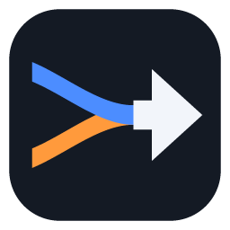

🇬🇧 English · [🇫🇷 Français](README.fr.md)

# Hi, I'm Nassim 👋

**Flutter mobile developer · France**

*I build tools that solve my own needs, hoping they can be useful to others too.*

---

## 🧑‍💻 About

I mainly work with **Flutter and Dart**. My projects are often experiments around tools that answer my own needs, with the hope that they can be useful to others too.

## 🧰 Tech stack

**Core of my work**

**Other technologies used in my projects**

## 🚀 Public projects

<table>
  <tr>
    <td width="50%" valign="top">
      <h3> <a href="https://github.com/NassB/dualnet">dualnet</a></h3>
      Windows tool to combine several Internet connections on a single PC, with no remote server.  
      <a href="https://github.com/NassB/dualnet/releases/latest">⬇️ Download</a>
    </td>
    <td width="50%" valign="top">
      <h3><a href="https://github.com/NassB/database_benchmarks">📊 database_benchmarks</a></h3>
      Flutter app to compare mobile databases under reproducible conditions.
    </td>
  </tr>
  <tr>
    <td width="50%" valign="top">
      <h3> <a href="https://github.com/NassB/walking-pad-distance-modifier">walking-pad-distance-modifier</a></h3>
      Chrome extension to adjust distances in walking pad activity files.
    </td>
    <td width="50%" valign="top">
      <h3><a href="https://github.com/NassB/mhp3rd-translation-toolkit">🛠️ mhp3rd-translation-toolkit</a></h3>
      Dart toolkit <em>(in development)</em> to build translation and modding tools for Monster Hunter Portable 3rd.
    </td>
  </tr>
</table>

## 📈 Activity

GitHub's native contribution graph is visible on [my profile](https://github.com/NassB), where all my public repositories can also be found.
